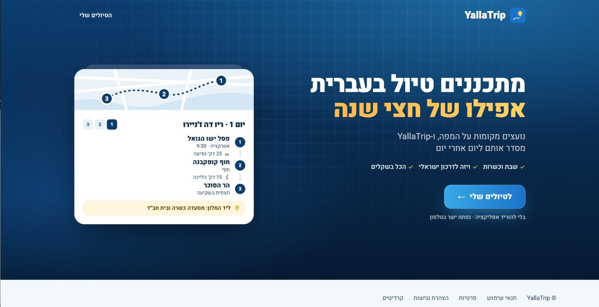
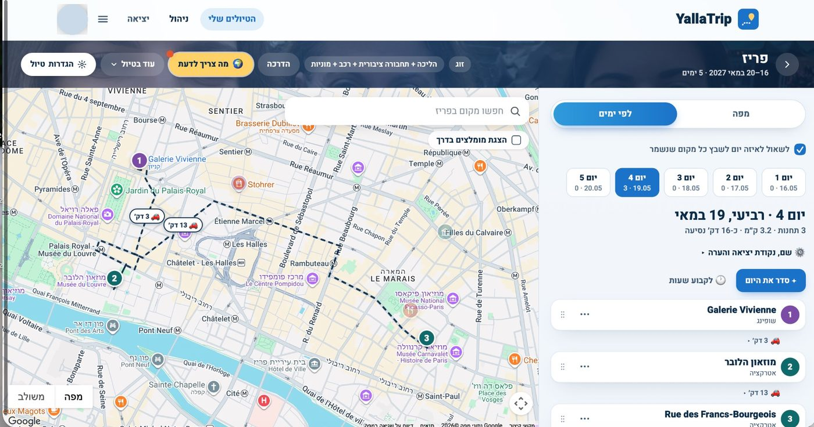
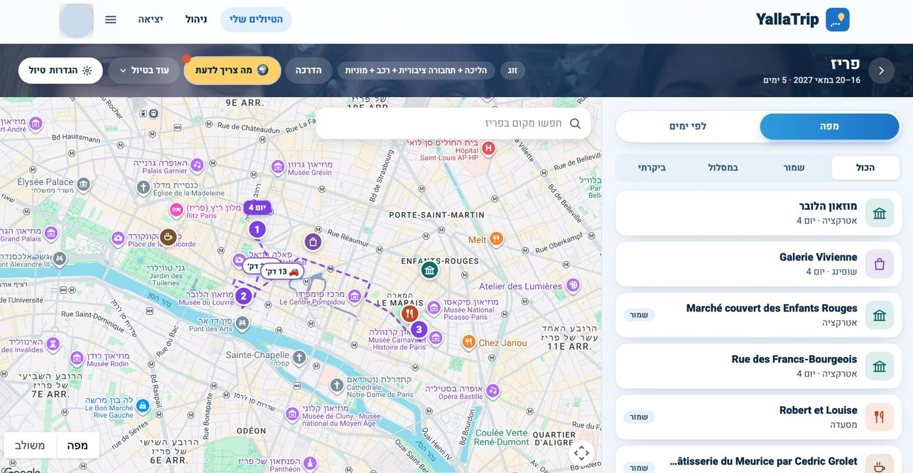
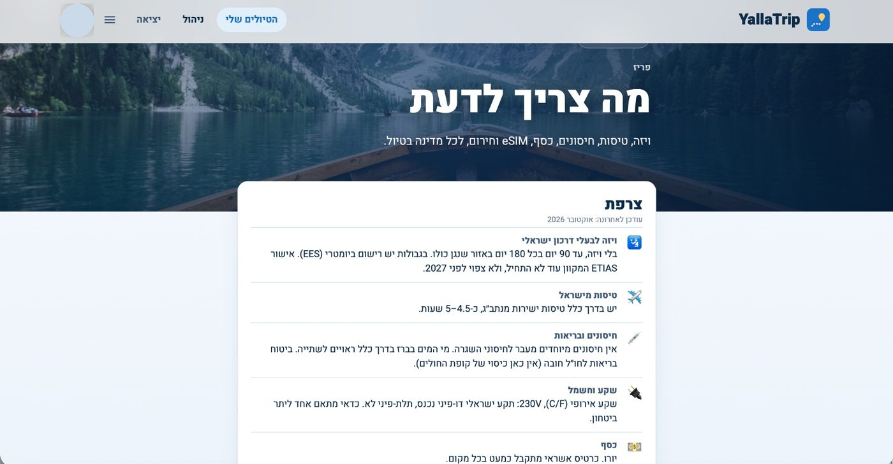

# YallaTrip

**YallaTrip is a Hebrew, phone-first trip planner for Israeli travellers: pin places on a map, get ideas nearby, and turn even a six-month trip into a clear plan, day by day.**

🌍 **Live site:** https://gotrip-go-trip1.vercel.app

> This is a portfolio copy. All rights reserved. See [LICENSE](LICENSE).

[עברית בהמשך ↓](#עברית)

---

## Screenshots

<table>
  <tr>
    <td width="50%"><br><sub><b>Landing page</b>: what YallaTrip does, with an example day</sub></td>
    <td width="50%"><br><sub><b>Day by day</b>: stops in order, travel time between them, the route on the map</sub></td>
  </tr>
  <tr>
    <td width="50%"><br><sub><b>Map</b>: everything saved for the trip, and which day each place is on</sub></td>
    <td width="50%"><br><sub><b>Before you fly</b>: visa for an Israeli passport, direct flights, plugs, money</sub></td>
  </tr>
</table>

## Main features

- **Map first:** search any place (Google Places), open a place card with hours, rating and tickets, and save it to the trip in one tap.
- **"What's around":** food, places to stay, sights and getting there, near any saved place.
- **Day by day:** every date of the trip becomes a day. Drag stops into order, let "arrange my day" find the shortest route, and see walking, driving or transit time between every two stops.
- **Long, multi-country trips:** several destinations in one trip, with nights split between them and adjustable later.
- **"Today":** the next stop with one-tap navigation, kept on the phone for use without internet.
- **Made for Israeli travellers:** visa rules for an Israeli passport, direct flights from Israel, prices in shekels, and Shabbat times and kosher food for those who want them.
- **Plan together:** invite friends by link and see each other's changes live. Also a packing checklist, a budget in ₪, and a photo album (optionally in your own Google Drive).
- **Like an app:** add it to the home screen on iPhone or Android, full screen, with an in-app guided tour for every screen.

## Tech stack

| | |
|---|---|
| **Frontend** | Next.js 16 (App Router, React 19), TypeScript, Tailwind CSS 4 |
| **Backend** | Next.js server actions and API routes on Vercel |
| **Database** | Supabase: PostgreSQL with Row Level Security, Auth (email and Google), Storage |
| **Maps** | Google Maps Platform: Maps JavaScript API, Places API (New), Routes API |
| **Hosting** | Vercel, with a preview deployment for every branch |
| **Offline** | A service worker and web app manifest (installable PWA) |

## Architecture

```mermaid
flowchart LR
  P["📱 Phone browser<br/>or home-screen app"] -->|pages, server actions| V["Next.js on Vercel<br/>(server components,<br/>API routes)"]
  P -->|map tiles| M["Google Maps<br/>JavaScript API"]
  V -->|SQL with RLS,<br/>auth, files| S[("Supabase<br/>PostgreSQL + RLS")]
  V -->|places, routes<br/>(server key only)| G["Google Places API (New)<br/>Google Routes API"]
  V -.->|count each call<br/>against monthly ceilings| S
  P <-->|offline copy of trips| W["Service worker"]
```

- The browser never sees the server API key. Every costly Google call goes through a server route that checks the user, a per-user daily limit and a site-wide monthly ceiling first.
- Every table is protected by Row Level Security: a traveller can read and change only their own trips, and the trips shared with them.

## How I built it

I'm the product owner and I don't write code. YallaTrip was built in conversation with [Claude Code](https://claude.com/claude-code). The full working method is in [AI_WORKFLOW.md](AI_WORKFLOW.md).

1. **Specification first:** each feature started as a short written spec covering who it is for, what it changes on the phone, and what it must not do.
2. **AI-assisted development:** Claude Code wrote the code against a fixed set of project rules covering phone-first layout, Hebrew right-to-left text, no secrets in code, approval before any database change, and approval before anything that costs money.
3. **A branch and a preview for every change:** every request got its own branch and its own Vercel preview link. I reviewed each one on my phone before anything was merged to the live site.
4. **Phone QA:** every screen was checked at 360 px, 390 px and desktop width, across iPhone Safari, in-app browsers and Android Chrome, plus type checks and automated tests before each push.
5. **A monthly cost ceiling for the APIs:** Google usage is kept inside the free tier with daily quotas in Google Cloud, monthly ceilings counted in the database that reset by themselves, and a budget alert.

---

<div dir="rtl">

## עברית

**YallaTrip הוא אתר בעברית לתכנון טיולים, שנבנה קודם כל לטלפון ולמטיילים ישראלים. נועצים מקומות על המפה, מקבלים רעיונות בסביבה, והופכים גם טיול של חצי שנה לתוכנית ברורה, יום אחרי יום.**

🌍 **האתר החי:** https://gotrip-go-trip1.vercel.app

> זהו עותק לתיק עבודות. כל הזכויות שמורות. ראו [LICENSE](LICENSE).

צילומי המסך מופיעים בראש העמוד.

### מה אפשר לעשות

- **מפה קודם כל:** מחפשים כל מקום, פותחים כרטיס עם שעות, דירוג וכרטיסים, ושומרים לטיול בלחיצה.
- **"מה יש בסביבה":** אוכל, לינה, אטרקציות ואיך מגיעים, ליד כל מקום ששמרתם.
- **לפי ימים:** כל תאריך בטיול הוא יום. גוררים תחנות לפי הסדר, "סדר את היום" מוצא את המסלול הקצר, ובין כל שתי תחנות רואים כמה זמן ברגל, ברכב או בתחב"צ.
- **טיולים ארוכים וכמה מדינות:** כמה יעדים בטיול אחד, והלילות מתחלקים ביניהם.
- **"היום":** התחנה הבאה עם ניווט בלחיצה, שמור בטלפון גם בלי אינטרנט.
- **בשביל מטיילים ישראלים:** ויזה לדרכון ישראלי, טיסות ישירות, מחירים בשקלים, וזמני שבת ואוכל כשר למי שרוצה.
- **מתכננים יחד:** מזמינים חברים בקישור ורואים שינויים מיד. יש גם רשימת הכנות, תקציב בשקלים ואלבום תמונות.
- **כמו אפליקציה:** מוסיפים למסך הבית באייפון או באנדרואיד, ויש הדרכה לכל מסך.

### טכנולוגיות

Next.js, TypeScript, Tailwind, Supabase (PostgreSQL + RLS), Google Maps Platform, Vercel.

### איך בניתי את זה

אני מנהלת המוצר, ואני לא מתכנתת. YallaTrip נבנה בשיחה עם Claude Code. שיטת העבודה המלאה כתובה ב-[AI_WORKFLOW.md](AI_WORKFLOW.md).

1. **אפיון קודם:** כל פיצ'ר התחיל באפיון קצר: למי הוא, מה הוא משנה בטלפון, ומה אסור לו לעשות.
2. **פיתוח עם AI:** Claude Code כתב את הקוד לפי כללים קבועים: טלפון קודם, עברית מימין לשמאל, בלי סודות בקוד, ואישור לפני כל שינוי במסד ולפני כל דבר שעולה כסף.
3. **ענף ותצוגה מקדימה לכל שינוי:** כל בקשה קיבלה ענף משלה וקישור תצוגה מקדימה. בדקתי כל אחד בטלפון לפני שעלה לאתר.
4. **בדיקות בטלפון:** כל מסך נבדק ברוחב 360, 390 ובמחשב, באייפון, בדפדפנים של אפליקציות ובאנדרואיד, יחד עם בדיקות אוטומטיות לפני כל דחיפה.
5. **תקרת עלויות חודשית ל-API:** השימוש ב-Google נשאר בתוך המכסה החינמית, בעזרת תקרה יומית ב-Google Cloud, תקרות חודשיות בקוד שמתאפסות לבד, והתראה במייל.

</div>
